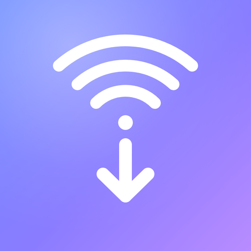
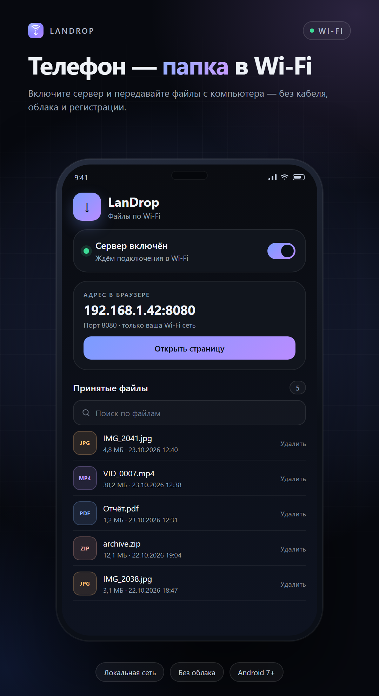
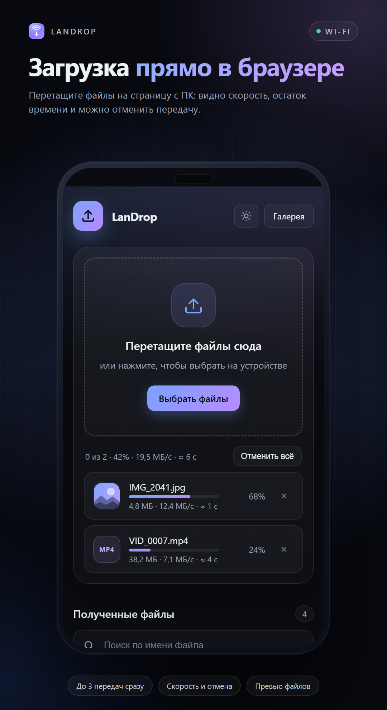
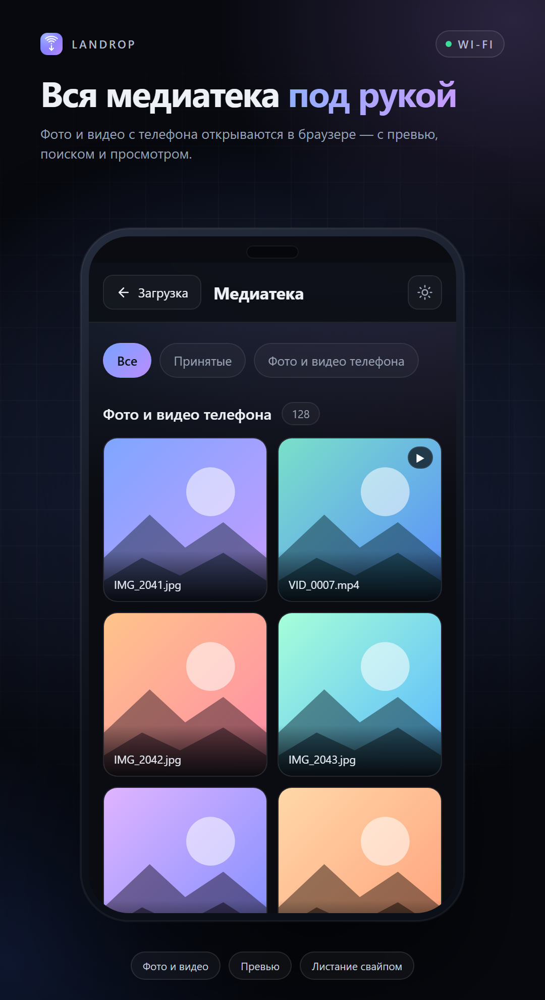
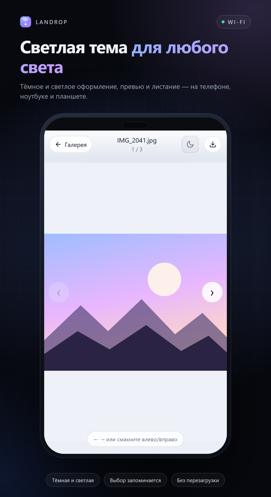
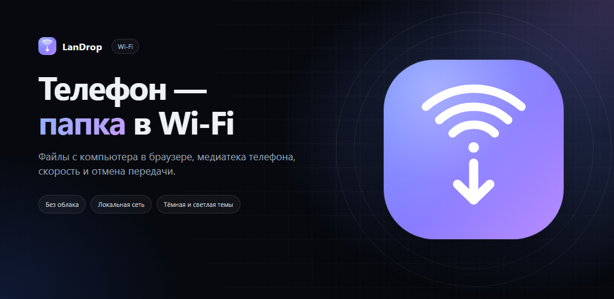

# LanDrop

**Телефон — папка в Wi-Fi.**

LanDrop превращает Android-телефон в общую папку локальной сети: приложение поднимает HTTP-сервер, а файлы с компьютера загружаются через обычный браузер — без кабеля, облака, аккаунтов и интернета. Там же открывается галерея фото и видео с телефона.

<p align="left">
  
</p>

## Возможности

- **Передача с ПК через браузер.** Drag-and-drop или выбор файлов на странице `http://<IP-телефона>:8080`.
- **Частичный доступ.** Пока сервер включён, выбирается, что видно клиентам: всё, только галерея телефона, только отмеченные файлы или файлы и фото за сегодня, вчера или любую дату. Фильтр общий для всей страницы: список, прямые ссылки и превью скрытых файлов отвечают пусто.
- **Долгое хранение.** WebDAV-папка на вашем компьютере, NAS или роутере как архив: принятые файлы выгружаются туда в фоне с прогрессом и повтором при обрыве Wi-Fi.
- **Очередь загрузки.** До трёх файлов одновременно, скорость, оставшееся время, отмена одного файла или всей очереди.
- **Превью.** Миниатюры картинок в очереди и в списке принятых файлов, кадры видео в галерее.
- **Галерея телефона.** Фото и видео из медиатеки открываются в браузере: вкладки источников, ленивые превью, поиск.
- **Удаление из галереи.** Кнопка «×» на карточке удаляет элемент: принятый файл уходит в корзину, а снимок из медиатеки телефона Android удаляет после подтверждения на самом телефоне (уведомление или карточка в приложении).
- **Просмотрщик.** Листание стрелками, свайпами и клавиатурой, скачивание оригинала, поддержка `Range` для видео.
- **Светлая и тёмная темы.** Переключатель на каждой странице, выбор запоминается; без выбора используется системная тема.
- **Папки.** Принятые файлы можно раскладывать по папкам: создать папку, загрузить файл сразу внутрь неё, переименовать или переместить. Навигация по папкам есть и в приложении, и в браузере, и в окне чужого телефона.
- **Сетка и список в браузере.** Переключатель вида запоминается, файлы и папки выделяются чекбоксами, а выбранное удаляется одним запросом.
- **Корзина и отмена.** Удаление больше не стирает сразу: файлы и папки переезжают в скрытую папку `.trash`, внизу страницы появляется «Отменить», а на странице `/trash` элемент можно вернуть на исходное место или стереть окончательно. Перед удалением больше не нужно подтверждать каждый файл.
- **Видеотека.** Все видео из папки приёма — карточками с кадром, заголовком и описанием. Описание редактируется на странице `/library` и хранится рядом с видео в `*.library.json`, поэтому переезжает вместе с файлом.
- **Папка одним архивом.** Кнопка «Скачать ZIP» отдаёт текущую папку со всем содержимым, не собирая архив в памяти телефона.
- **Сетка принятых файлов в приложении.** Превью фото и видео, папки, поиск, открытие во внешнем приложении; долгое нажатие включает выделение — группу файлов и папок можно удалить, переместить или отправить в хранилище одним действием, а выбранный один элемент — переименовать. На каждой плитке есть меню «⋮» с теми же действиями — без долгого нажатия.
- **Отмена удаления в приложении.** После удаления внизу появляется снекбар «Отменить»; если он закрылся, файлы ждут на странице `/trash`.
- **Подключение по QR.** На главном экране — QR со страницей-мостиком: приложение на втором телефоне открывает встроенный просмотр, без приложения открывается браузер.
- **Сканер QR в приложении.** Недавние телефоны сохраняются — повторное подключение в один тап.
- **Просмотр с другого телефона в приложении.** Галерея и принятые файлы без браузера, отправка файлов на телефон-хост; по долгому нажатию файлы и папки на хосте выделяются и удаляются или перемещаются группой, а значок «✎» переименовывает элемент.
- **Скачивание на второй телефон.** Кнопка «Сохранить» в просмотрщике тянет оригинал с хоста и кладёт его в системные «Загрузки» с прогрессом: на Android 10+ через `MediaStore`, на более старых версиях — с разрешением на запись.
- **Живое обновление.** Удалённое окно само подтягивает новые файлы и галерею каждые несколько секунд.
- **Видео внутри приложения.** Нативный плеер с перемоткой вместо перехода в браузер.
- **Приём через «Поделиться».** Из галереи или проводника файл можно отправить в папку LanDrop, сразу на недавний телефон или сразу в хранилище.
- **Выгружать и удалять.** При отправке файла в хранилище приложение каждый раз спрашивает: оставить копию на телефоне или удалить её после успешной выгрузки.
- **Копия в Галерею.** Принятые фото и видео по желанию попадают в `Pictures/LanDrop` и `Movies/LanDrop`.
- **Без перезаписи.** Одинаковые имена получают суффикс: `photo (1).jpg`.
- **Два способа передачи на одном порту.** HTTP для браузера и бинарный протокол для скриптов; сервер сам определяет протокол по первым байтам.

## Скриншоты

Материалы для публикации лежат в [`screenshots/`](screenshots/): четыре скриншота **1080 × 1980 px**, обложка 1024 × 500 и иконка 512 × 512. Английская версия скриншотов и обложки — в [`screenshots/en/`](screenshots/en/).
На скриншотах демонстрационные IP-адреса и файлы. Тексты карточки для магазина — в [`store/`](store/).

| | | |
|:--:|:--:|:--:|
|  |  |  |
| Главный экран | Загрузка и отмена | Медиатека |
|  |  |  |
| Светлая тема | Иконка 512 × 512 | Обложка 1024 × 500 |

Английские макеты: [01-app-main](screenshots/en/01-app-main.png), [02-web-upload](screenshots/en/02-web-upload.png), [03-gallery](screenshots/en/03-gallery.png), [04-light-viewer](screenshots/en/04-light-viewer.png), [обложка](screenshots/en/feature-graphic.png).

## Как пользоваться

1. Подключите компьютер и телефон к одной Wi-Fi сети.
2. Откройте LanDrop и включите **«Сервер включён»**.
3. На компьютере откройте адрес с главного экрана, например `http://192.168.1.42:8080`.
4. Перетащите файлы на страницу — они появятся в списке «Принятые файлы».
5. Кнопка **Галерея** на странице открывает фото и видео с телефона.

Второй телефон может подключиться по QR с главного экрана: сканер откроет `http://<IP>:8080/open`, страница предложит приложение LanDrop (`landrop://connect?host=…&port=…`), а без него останется веб-интерфейс. В приложении то же окно показывает файлы и галерею хоста и умеет отправлять файлы обратно. Кнопка **«Сканировать QR»** на главном экране делает то же самое без браузера, а адреса недавних телефонов остаются под ней.

Чтобы отправить файл с телефона, выберите **«Поделиться» → LanDrop** в любом приложении: файл можно сохранить в общую папку, отправить на недавний телефон или отправить в хранилище. Включённый тумблер **«Фото и видео в Галерею»** дополнительно копирует принятые снимки в системную Галерею; копия живёт отдельно, удаление файла в LanDrop её не затрагивает.

## Частичный доступ

Рядом со статусом сервера есть строка **«ЧТО ВИДНО КЛИЕНТАМ»** — режим выбирается при каждом включении и хранится до следующего изменения:

- **Всё** — принятые файлы и галерея телефона, как обычно.
- **Галерея** — видна только медиатека телефона; список принятых файлов и прямые ссылки на них не открываются.
- **Выбор…** — открывается список с галочками: клиенты видят только отмеченные файлы, галерея телефона скрыта.
- **Сегодня / Вчера / Дата…** — видны принятые файлы и элементы галереи, полученные за выбранный день (по времени получения и дате снимка).

Режим применяется ко всем маршрутам сразу: списку на странице, JSON и превью. Ссылки на скрытые файлы отвечают 404. Загрузка новых файлов работает в любом режиме.

## Хранилище (WebDAV)

Экран **«Хранилище»** на главном экране нужен, чтобы файлы жили дольше телефона:

1. Укажите адрес WebDAV-папки в локальной сети, например `http://192.168.1.10:5005/landrop`, логин и пароль, нажмите **«Проверить»**, затем **«Сохранить»**.
2. С главного экрана: выделите файлы долгим нажатием (можно сразу несколько) и нажмите **«В хранилище»**. Приложение каждый раз спрашивает, удалять ли файлы с телефона после выгрузки.
3. Отправляйте файлы туда же через **«Поделиться» → LanDrop** — экран хранилища сам примет их.

Выгрузки идут по одной в фоновом потоке, даже когда сервер выключен. Статусы видны в хранилище: в очереди, выгружается с прогрессом, на сервере, ошибка с повтором. Прервавшаяся Wi-Fi выгрузка остаётся в очереди и доедет при следующем запуске приложения. Права на запись в WebDAV-папку нужны стандартные; сервер должен поддерживать `PUT` (Nextcloud, Synology Drive, почти любой NAS и веб-сервер).

### Автоархивация

В хранилище есть переключатель **«Автоархивация»** — по умолчанию выключен. При включении выбирается возраст: 1, 3, 7 или 30 дней. Файлы старше этого срока приложение само ставит в очередь выгрузки и удаляет с телефона после успеха; файлы, о которых уже есть запись в хранилище, повторно не выгружаются.

Приложение проверяет старые файлы раз в ~15 минут, когда открыто, и сразу после включения настройки. Пока приложение не запущено, автоархивация не работает — фонового сервиса у LanDrop нет. Главный экран показывает, сколько файлов автоархивация поставила в очередь, — счётчик рядом с надписью «Хранилище».

Для галереи Android 13+ нужен доступ к фото и видео (`READ_MEDIA_IMAGES`, `READ_MEDIA_VIDEO`); на Android 14 можно выдать доступ только к выбранным файлам. Без разрешения работает всё остальное, а галерея показывает только принятые файлы.

## Сборка и тесты

Требования: JDK 17+ (проект собран на JDK 25), Android SDK (compileSdk 37), Gradle wrapper 9.6 из репозитория.

```bash
./gradlew assembleDebug          # APK: app/build/outputs/apk/debug/app-debug.apk
./gradlew testDebugUnitTest      # JVM-тесты, эмулятор не нужен
```

Тесты HTTP-сервера, протокола, сохранения файлов и галереи работают на loopback-сокетах и не зависят от Android API.

## HTTP API

Сервер слушает порт **8080** и отвечает на запросы из локальной сети.

| Метод | Путь | Назначение |
|---|---|---|
| `GET` | `/` | Страница загрузки и список принятых файлов |
| `GET` | `/health` | Проверка доступности, `OK` |
| `GET` | `/open` | Страница-мостик для QR: приложение или веб-версия |
| `GET` | `/api/files[?path=<папка>]` | Содержимое папки (файлы и вложенные папки) в JSON |
| `GET` | `/api/folders` | Все папки хранилища — для перемещения |
| `GET` | `/files/<путь>` | Файл; `Range`, inline-просмотр для безопасных типов |
| `DELETE` | `/files/<путь>` | Удаление в корзину; папка — с `?recursive=1` |
| `GET` | `/zip?path=<папка>` | Текущая папка со всем содержимым одним ZIP |
| `POST` | `/folder?path=<папка>&name=<имя>` | Создание папки; занятое имя нумеруется |
| `POST` | `/rename?path=<путь>&name=<имя>` | Переименование файла или папки |
| `POST` | `/move?path=<путь>&to=<папка>` | Перемещение файла или папки |
| `POST` | `/delete` | Массовое удаление: по одному пути в строке тела, ответ содержит id корзины |
| `GET` | `/trash` | Корзина: вернуть элемент или стереть окончательно |
| `GET` | `/api/trash` | Корзина в JSON |
| `POST` | `/restore?id=<id>` | Восстановление элемента (или списка id в теле) |
| `POST` | `/trash/empty` | Очистить корзину |
| `DELETE` | `/trash/<id>` | Удалить элемент корзины навсегда |
| `GET` | `/library` | Видеотека: видео с заголовком и описанием |
| `GET` | `/api/library` | Видеотека в JSON |
| `POST` | `/library/save?path=<видео>&title=<заголовок>` | Сохранить описание; текст — в теле запроса |
| `POST` | `/library/reset?path=<видео>` | Убрать описание |
| `POST` | `/media/delete?src=<источник>&id=<элемент>` | Удалить элемент галереи; для медиатеки телефона может потребоваться подтверждение |
| `GET` | `/gallery` | Галерея фото и видео, фильтр `?src=<источник>` |
| `GET` | `/view?src=<источник>&id=<элемент>` | Просмотрщик с листанием |
| `GET` | `/api/media[?src=<источник>]` | Элементы галереи в JSON |
| `GET` | `/media?src=<источник>&id=<элемент>` | Оригинал фото/видео, поддержка `Range` |
| `GET` | `/thumb?src=<источник>&id=<элемент>` | JPEG-превью элемента галереи |
| `GET` | `/thumb-file?name=<имя>` | Превью принятого файла для списка |
| `POST`, `PUT` | `/upload?name=<имя>[&path=<папка>]` | Загрузка файла; нужен `Content-Length` |
| `OPTIONS` | любой | Список разрешённых методов |

Пример через `curl`:

```bash
curl --upload-file ./photo.jpg "http://192.168.1.42:8080/upload?name=photo.jpg"
```

Файл с существующим именем не заменяется: сервер сохранит его как `photo (1).jpg`. Недописанный при обрыве файл удаляется — частичные данные не остаются в хранилище.

Пути папок в API относительны корню принятых файлов и разделяются `/`. Сегменты `..`, абсолютные пути и пустые имена отклоняются, поэтому выйти за пределы папки приёма нельзя. Загрузка в папку:

```bash
curl --upload-file ./photo.jpg "http://192.168.1.42:8080/upload?name=photo.jpg&path=Отпуск/2026"
```

## Бинарный протокол

На том же порту работает простой протокол для скриптов и старых клиентов:

```
[2B: длина имени, unsigned short]
[NB: имя файла в UTF-8]
[8B: размер файла, big-endian long]
[MB: содержимое]
ответ: 1 байт — 0x01 успех, 0x00 ошибка
```

Клиент для проверки:

```bash
python scripts/send_file.py 192.168.1.42 ./test.txt
python scripts/send_file.py 192.168.1.42 ./test.txt 8080
```

## Бренд и дизайн

- **Название:** LanDrop — LAN + drop: «бросить файл в локальную сеть».
- **Слоган:** «Телефон — папка в Wi-Fi».
- **Палитра:** фон `#0A0C11`, тёмная поверхность `#11151D`, светлая тема `#F5F7FB`, акценты `#6C8CFF → #B98CFF`, успех `#3DDC97`.
- **Иконка:** градиентный квадрат с Wi-Fi-дугами и стрелкой приёма; SVG — [`screenshots/icon.svg`](screenshots/icon.svg), растровая версия — 512 и 1024 px.
- **Шрифт:** системный (system-ui / Roboto), без внешних CDN.
- Иконки лаунчера обновлены в `app/src/main/res/mipmap-*` и `drawable/ic_launcher_*`.

## Ассеты для магазина

```
screenshots/
├── 01-app-main.png      1080 × 1980 — главный экран
├── 02-web-upload.png    1080 × 1980 — очередь загрузки
├── 03-gallery.png       1080 × 1980 — галерея
├── 04-light-viewer.png  1080 × 1980 — светлая тема, просмотр
├── feature-graphic.png  1024 × 500 — обложка карточки
├── icon-512.png         512 × 512 — иконка для магазина
├── icon-1024.png        1024 × 1024 — исходник
├── icon.svg             векторная иконка
└── en/                  английские скриншоты и обложка
```

Скриншоты и иконки собраны из реальных шаблонов веб-интерфейса и макета главного экрана. Пересобрать всё:

```bash
python scripts/make_store_assets.py
```

Скрипту нужны headless Chrome и Pillow; он также обновляет иконки лаунчера. Подробнее — [`screenshots/README.md`](screenshots/README.md).

Тексты карточки на русском и английском с проверенными лимитами Google Play и чек-листом публикации — в [`store/README.md`](store/README.md).

## Структура проекта

```
app/src/main/java/Code_SyS/nas_server/
├── MainActivity.kt          # экран LanDrop: статус, адрес, файлы
├── FileReceiverService.kt   # foreground-сервис с сервером
├── FileReceiverServer.kt    # сокет, определение HTTP/бинарного протокола
├── HttpRequestHandler.kt    # маршруты, загрузка, галерея, превью
├── WebTemplates.kt          # HTML/CSS/JS страниц
├── RemoteActivity.kt        # окно просмотра чужого телефона
├── RemoteClient.kt          # HTTP-клиент к телефону-хосту
├── ScanActivity.kt          # сканер QR на CameraX
├── ShareLinks.kt            # адрес, deep link и разбор ссылок
├── RecentHosts.kt           # недавние телефоны
├── QrCode.kt                # QR-код для подключения
├── AccessMode.kt            # режимы частичного доступа и фильтры
├── WebDavClient.kt          # выгрузка в WebDAV без Android API
├── VaultStore.kt            # записи очереди хранилища
├── ArchiveManager.kt        # фоновая очередь выгрузки
├── VaultActivity.kt         # экран «Хранилище»
├── ShareReceive.kt          # диалог «Поделиться»
├── SharedFile.kt            # чтение файлов из content://
├── GallerySaver.kt          # копия принятых медиа в Галерею
├── MediaSource.kt           # источники галереи
├── DeviceMediaSource.kt     # фото и видео телефона
├── Thumbnails.kt            # JPEG-превью фото и видео
├── FileSaver.kt             # сохранение и список принятых файлов
├── ReceivedStorage.kt       # папки приёма: пути, создание, перемещение, удаление, корзина
├── MediaLibrary.kt          # видеотека: видео, описания в *.library.json
├── PendingDeletes.kt        # фото/видео, ждущие подтверждения удаления
├── DeleteConsentActivity.kt # системный диалог «разрешить удаление»
├── Protocol.kt              # бинарный протокол
├── NetworkUtils.kt          # Wi-Fi IP и состояние сети
├── FileFormat.kt            # подписи размера и даты
└── ui/theme/Theme.kt        # брендовая тема Compose
```

Принятые файлы хранятся в приватной внешней папке приложения:
`Android/data/Code_SyS.nas_server/files/Download`; вложенные папки — там же.
Имена папок и файлов проверяются до обращения к диску, а удаление папки
всегда рекурсивное. Удалённое лежит в скрытой папке `.trash` — она не видна
в списках, архивах и галерее, пока файл не вернут или не очистят корзину.
Описания видео хранятся рядом с файлом в `*.library.json` и тоже скрыты.

## Безопасность и ограничения

- Сервер работает только в локальной сети и **не имеет авторизации**: любой в этой Wi-Fi сети может загружать, переименовывать, перемещать и удалять файлы и папки. Не публикуйте порт в интернет. Частичный доступ ограничивает, что видно, но не закрывает сеть от чужих глаз и загрузок.
- Соединение без TLS — это осознанный выбор для быстрой передачи внутри доверенной сети.
- Пароль WebDAV лежит в приватных настройках приложения; хранилище лучше держать в доверенной сети — трафик, как и у самого сервера, идёт по HTTP.
- Аудиодорожки некоторых видео (DTS/AC3 в MKV) встроенный плеер может не воспроизвести; из окна просмотра остаётся кнопка «В браузере» и скачивание оригинала.
- Приложение не отправляет данные в интернет. Для QR-кодов подключена офлайн-библиотека ZXing (`com.google.zxing:core`), разрешений и сетевых обращений она не добавляет.
- Камера используется только встроенным сканером QR. Доступ к фото и видео нужен для показа медиатеки телефона.
- Копия в Галерею создаётся отдельным файлом: удаление принятого файла в LanDrop не удаляет его из Галереи.
- Удаление фото и видео из медиатеки телефона на Android 11+ требует подтверждения: запрос приходит уведомлением «Подтвердите удаление» или карточкой на главном экране LanDrop. Без подтверждения файл остаётся на телефоне.
- Корзина и описания видео доступны в веб-интерфейсе так же, как обычные файлы: отдельной авторизации у сервера нет.

## Лицензия

Лицензия в репозитории не указана.
